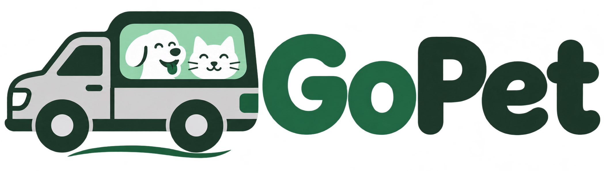

# Logo GoPet · propuesta PNG

**Estado:** propuesta de trabajo, aún sin aprobación final. **Nombre:** GoPet, elegido por el emprendedor el 2026-11-19. La disponibilidad registral y digital del nuevo nombre sigue sin comprobarse.

## Concepto

La imagen muestra una camioneta compacta con cúpula, un perro y un gato visibles en la ventana y una línea corta de recorrido bajo las ruedas. Usa los verdes de la [guía visual](../../direccion-visual-verde-pastel.md), gris claro para la carrocería y gris oscuro para la cúpula. El objetivo es comunicar **mascotas + traslado** de inmediato, con un tono amable y profesional.

## Archivos vigentes

| Archivo | Uso |
| --- | --- |
| [gopet-horizontal.png](gopet-horizontal.png) | Logo completo con nombre; PNG transparente de 2097 × 596 px. |
| [gopet-icono.png](gopet-icono.png) | Camioneta y mascotas sin nombre; PNG transparente cuadrado de 1254 × 1254 px para avatar y piezas pequeñas. |
| [gopet-original-generado.png](gopet-original-generado.png) | Original generado, conservado antes del recorte de márgenes. |
| [`apps/web/public/assets/gopet-horizontal.png`](../../../../apps/web/public/assets/gopet-horizontal.png) | Copia optimizada a 720 × 204 px para la maqueta web. |
| [`apps/web/public/assets/gopet-favicon.png`](../../../../apps/web/public/assets/gopet-favicon.png) | Icono PNG de 64 × 64 px para navegador. |

Todos los archivos de logo vigentes son **PNG con transparencia real**. El concepto vectorial anterior fue rechazado y puede recuperarse desde el historial de Git; no debe utilizarse.

## Uso inicial

- Utilizar el horizontal cuando el nombre pueda leerse; reservar el icono para perfiles y espacios cuadrados.
- Mantener un margen libre alrededor del dibujo y conservar siempre sus proporciones.
- Sobre el blanco cálido y el verde niebla de la web se lee bien. Antes de usarlo sobre gris oscuro, fotografías o la camioneta real, comprobar el contraste en una muestra del material.
- Es una imagen raster. El archivo de 2097 px permite usos digitales e impresiones moderadas; para un rótulo grande hay que verificar medidas y resolución final antes de enviarlo a producción.

## Procedencia

El logo horizontal se editó el 2026-11-19 con la herramienta integrada `image_gen` para cambiar el rótulo a «GoPet» y conservar la camioneta y las mascotas. El PNG horizontal se recortó para quitar espacio transparente sobrante y se exportó una copia web. El icono y el favicon, que no contienen texto, se conservaron con nuevos nombres de archivo. No incorpora fotos de clientes, mascotas reales ni imágenes del vehículo real.
