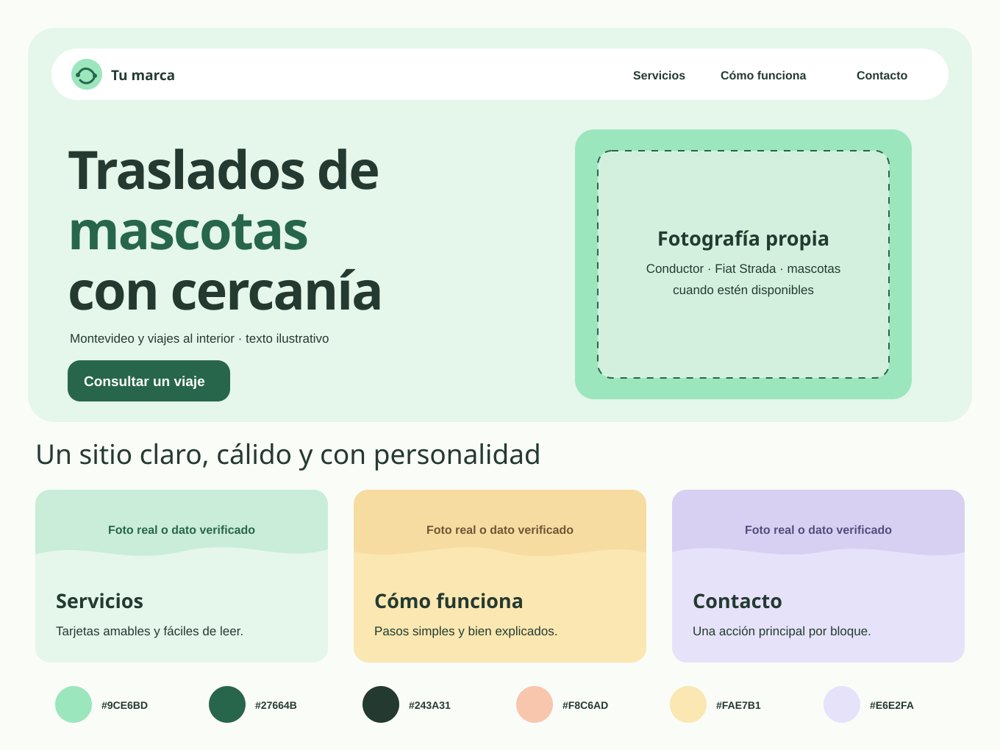

# Dirección visual: verde pastel y cercanía profesional

**Estado:** dirección general confirmada por el emprendedor; valores exactos y aplicaciones todavía en prueba.  
**Fecha:** 2026-11-13.  
**Origen:** preferencia por verdes pastel cercanos a `#9CE6BD` y por una web profesional e informal como las [siete referencias aportadas](referencias/README.md).

## Idea visual

Una marca de transporte de mascotas **clara, cordial y fácil de reconocer**. La estructura ordenada y la lectura sencilla aportan profesionalidad; la tipografía redondeada, los colores suaves y las fotografías reales aportan cercanía. La expresión puede ser alegre sin convertir el sitio en un dibujo infantil.

## Paleta de trabajo

Estos códigos son **propuestas**, excepto `#9CE6BD`, que el emprendedor dio como referencia aproximada. Se ajustarán al verlos en pantalla, sobre fotos reales y sobre la Fiat Strada gris claro con cúpula gris oscuro.

| Rol | Código | Uso propuesto |
| --- | --- | --- |
| Menta principal | `#9CE6BD` | Superficies de marca, destacados, fondos de CTA con texto oscuro. |
| Verde tinta | `#243A31` | Titulares, párrafos y elementos de alto contraste. |
| Blanco cálido | `#FAFCF8` | Fondo general y descanso visual. |
| Verde niebla | `#E5F6EB` | Secciones y tarjetas suaves. |
| Verde acción | `#27664B` | Botón principal con texto blanco, enlaces y estados activos. |
| Durazno suave | `#F8C6AD` | Acento cálido pequeño y alguna tarjeta secundaria. |
| Amarillo manteca | `#FAE7B1` | Variación ocasional de tarjeta. |
| Lila pálido | `#E6E2FA` | Variación ocasional de tarjeta. |

El menta puede ser protagonista **sin usar blanco sobre él**: esa pareja tiene solo `1,45:1` de contraste. Verde tinta sobre menta alcanza `8,39:1`; verde tinta sobre blanco cálido `11,80:1`; blanco sobre verde acción `6,80:1`, según cálculo de contraste WCAG. Para texto normal, [WCAG 2.2 exige al menos `4,5:1`](https://www.w3.org/WAI/WCAG22/Understanding/contrast-minimum). Estos valores prueban únicamente las parejas indicadas; habrá que comprobar cada aplicación final, especialmente texto sobre fotografía.

## Aplicación inicial en la camioneta

**Dato confirmado:** carrocería gris claro y cúpula gris oscuro. No conocemos los códigos exactos de la pintura ni disponemos aún de fotos para evaluar el rótulo sobre el vehículo real.

- **Carrocería gris claro:** probar nombre y datos esenciales en verde tinta o verde acción. El menta puede aparecer como franja, sello o recorrido breve; evitar texto pequeño en menta directamente sobre el gris claro.
- **Cúpula gris oscuro:** si se decide rotularla, probar un símbolo o texto grande en menta claro o blanco cálido. Comprobar el contraste sobre ese gris concreto y evitar tapar ventanas.
- **Conjunto:** el gris existente puede funcionar como base neutra de la marca. Mantener la gráfica simple para que se lea a distancia y en movimiento.
- **Pendiente:** confirmar qué superficies se rotularán y hacer una prueba con fotografías de ambos laterales y la parte trasera.

## Lenguaje de la web

- **Titulares:** grandes, cortos, redondeados y con peso alto. Una sola palabra destacada en verde por título cuando ayude a leer; evitar bloques largos en mayúsculas.
- **Texto de apoyo:** una sans serif más sobria y legible. Candidatas tipográficas para probar: **Fredoka** en titulares y **Nunito Sans** en texto; se confirmarán al verlas con contenido real en español y en móvil.
- **Composición:** barra de navegación clara y redondeada; secciones con aire; un objetivo principal por bloque; botones visibles con verbos concretos.
- **Tarjetas:** fotos reales en la parte superior y paneles de color pastel para el texto. El borde ondulado de las referencias puede aparecer en una familia de tarjetas, como recurso distintivo controlado.
- **Fotografía:** primero el conductor, la Fiat Strada real, el espacio acondicionado y mascotas con permiso de sus tutores. Fotos luminosas y naturales; el vehículo y el modo de transporte deben poder verse con claridad.
- **Detalles gráficos:** una línea de recorrido, marcas de ubicación e iconos de trazo uniforme. Un patrón muy tenue puede reservarse para alguna banda amplia; el texto largo va sobre superficies limpias.
- **Tono:** cercano, directo y tranquilizador. El diseño no debe prometer prestaciones que aún no estén confirmadas en [Negocio](../01-negocio/README.md) y [Operaciones](../02-operaciones/README.md).

## Traducción de las referencias al proyecto

| Recurso visto en las capturas | Aplicación prevista |
| --- | --- |
| Hero con persona y mascotas | Fotografía propia del conductor, la Strada y los animales admitidos, cuando estén disponibles. |
| Bloques de beneficios con fotos | Explicar condiciones reales del viaje con fotografías de equipamiento y proceso verificables. |
| Proceso numerado con línea punteada | Mostrar consulta, cotización, confirmación, traslado y entrega, una vez fijado el flujo. |
| Tarjetas pastel con onda | Usar en servicios o información clave, con máximo contraste en textos y botones. |
| Chips de zonas | Mostrar solo zonas y rutas efectivamente aceptadas. |
| Preguntas frecuentes | Respuestas concisas basadas en políticas ya aprobadas. |
| Gran bloque de contacto | Una acción principal clara, según el canal de reserva elegido. |

## Aplicaciones por revisar

1. Prueba de legibilidad sobre fotografías de la carrocería gris claro y la cúpula gris oscuro.
2. Prueba en avatar, publicación de red social, tarjeta de contacto, web móvil y rótulo del vehículo.
3. Revisar la [propuesta PNG transparente de logo GoPet](activos/logo/README.md) junto con la tipografía final y las aplicaciones reales.
4. Fotografías propias y permisos para mostrar personas y mascotas.

Las [tres opciones de paleta anteriores](propuestas-paleta-y-estilo.md) quedan como historial de exploración. La dirección de trabajo actual es **verde pastel**.
