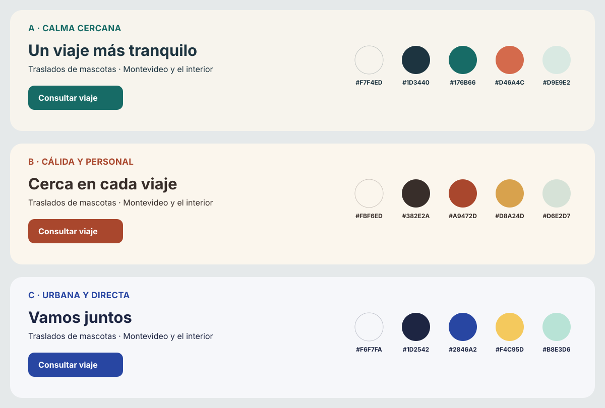

# Propuestas de paleta y estilo visual

**Estado:** historial de exploración; la [dirección verde pastel](direccion-visual-verde-pastel.md) elegida después guía el trabajo actual.  
**Fecha:** 2026-11-13.  
**Alcance histórico:** identidad visual futura del servicio de traslado de mascotas en Montevideo y hacia el interior. Desde esta exploración se confirmó que la Fiat Strada es gris claro y su cúpula gris oscuro; el nombre, el logo y las aplicaciones finales siguen pendientes. La [dirección actual](direccion-visual-verde-pastel.md) es verde pastel.

Los titulares de la muestra son textos ilustrativos para comparar estilos; no son un nombre ni una promesa comercial aprobada.

## A · Calma cercana

| Función | Color | Código |
| --- | --- | --- |
| Fondo cálido | Marfil | `#F7F4ED` |
| Texto principal | Azul petróleo oscuro | `#1D3440` |
| Marca y botón principal | Verde azulado | `#176B66` |
| Acento moderado | Coral | `#D46A4C` |
| Superficie secundaria | Verde agua pálido | `#D9E9E2` |

**Estilo:** formas suaves y limpias, mucho espacio libre, fotografía real del vehículo y de las mascotas cuando exista permiso, iconos lineales sencillos. Titulares de letra sin serif con curvas suaves y cuerpo muy legible. El coral se reserva para pequeños detalles; el verde azulado organiza la marca y las acciones principales.

**Impresión buscada:** trato cercano con presentación serena y ordenada. Es mi **recomendación provisional** para explorar primero, porque puede aplicarse con claridad tanto en la web como en el vehículo.

## B · Cálida y personal

| Función | Color | Código |
| --- | --- | --- |
| Fondo | Crema | `#FBF6ED` |
| Texto principal | Marrón carbón | `#382E2A` |
| Marca y botón principal | Terracota | `#A9472D` |
| Acento | Ocre | `#D8A24D` |
| Superficie secundaria | Salvia pálido | `#D6E2D7` |

**Estilo:** textura visual discreta, ilustraciones simples hechas a medida, bordes redondeados y fotografía espontánea. Tipografía con más personalidad y titulares cálidos. El resultado puede sentirse más artesanal y personal que una marca de transporte tradicional.

**Impresión buscada:** cercanía humana y trato personalizado. Las piezas deben mantener una composición sobria para que los mensajes de viaje se lean de inmediato.

## C · Urbana y directa

| Función | Color | Código |
| --- | --- | --- |
| Fondo | Blanco frío | `#F6F7FA` |
| Texto principal | Azul tinta | `#1D2542` |
| Marca y botón principal | Azul intenso | `#2846A2` |
| Acento | Amarillo suave | `#F4C95D` |
| Superficie secundaria | Menta pálido | `#B8E3D6` |

**Estilo:** composiciones geométricas, titulares contundentes, líneas que sugieran rutas y señalética clara. Fotografía con encuadres precisos. El amarillo aparece en detalles, no como fondo de texto pequeño.

**Impresión buscada:** servicio práctico y moderno, con una presentación cercana a la señalética de movilidad.

## Contraste y usos

Las combinaciones propuestas para **texto principal sobre fondo** y **texto blanco sobre botón principal** se calcularon con la fórmula de contraste de WCAG: A `11,82:1` y `6,30:1`; B `12,25:1` y `5,79:1`; C `14,05:1` y `8,44:1`, respectivamente. Superan el [mínimo WCAG de `4,5:1` para texto normal](https://www.w3.org/WAI/WCAG22/Understanding/contrast-minimum). Eso solo valida **esas parejas de colores**; cualquier uso distinto, texto sobre fotos o impresión deberá revisarse por separado. Los elementos visuales necesarios para operar la web también deben cumplir el [contraste no textual de `3:1`](https://www.w3.org/WAI/WCAG22/Understanding/non-text-contrast).

## Para decidir

1. Elegir la dirección que más represente el trato deseado: A, B, C o una combinación concreta.
2. Confirmar si la cúpula llevará gráfica y comprobar legibilidad sobre la pintura real de la Strada gris claro y la cúpula gris oscuro.
3. Acordar si la marca debe sentirse más **serena y profesional**, **cálida y personal** o **dinámica y urbana**.
4. Probar la opción elegida en tres tamaños: avatar de red social, portada de la web en móvil y rótulo del vehículo.

Tras la elección, registrar los colores finales y sus usos en [Estrategia e identidad](estrategia-e-identidad.md) y la razón en [Decisiones de marca](decisiones.md).
